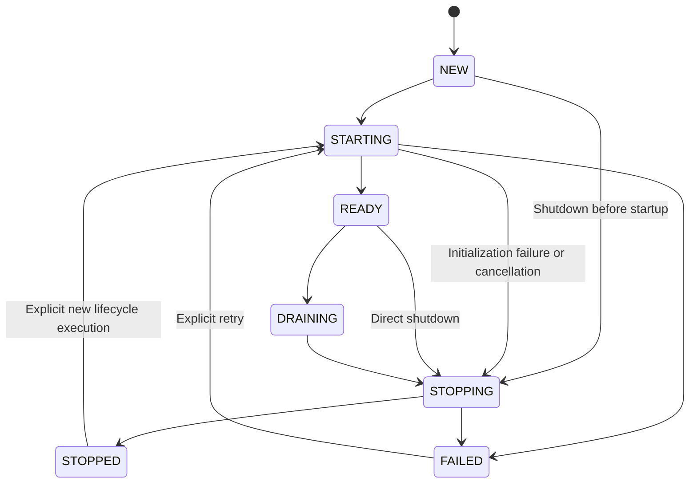
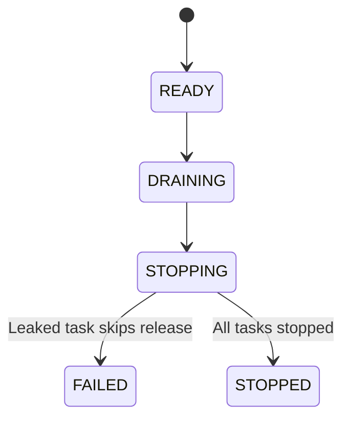

# Application Lifecycle Architecture (Stage 16)

**Owner:** Startup, resource ownership, shutdown, cancellation and lifecycle reliability.
**Does not cover:** Request-level retries (see `ERROR_HANDLING.md`) or telemetry configuration details (see `OBSERVABILITY_AND_LOGGING.md`).

---

## 1. One authoritative state per application instance

`src/waxprep/lifecycle/states.py` defines the only lifecycle state machine.
Booleans such as `shutting_down` remain for compatibility, but they are derived
signals; they never decide readiness, initialization order or cleanup.

| State | Meaning |
|---|---|
| `NEW` | Application created; initialization not started |
| `STARTING` | Mandatory initialization in progress |
| `READY` | Mandatory initialization completed; requests may be accepted |
| `DRAINING` | Termination began; readiness is already false |
| `STOPPING` | Background work stopped; resources being released |
| `STOPPED` | Cleanup completed (with or without recorded failures) |
| `FAILED` | A lifecycle operation failed; readiness remains false |



`LifecycleStateMachine.transition_to()` rejects every other transition with
`LifecycleTransitionError`. Components and request handlers cannot mutate the
state; only `ApplicationLifecycle` owns the machine.

`STOPPED` and `FAILED` are terminal for **one** lifecycle execution, not for the
application object. A deliberate new `start()` is allowed from either state and
reinitializes every component from scratch. A second `shutdown()` is idempotent
and never releases resources twice.

## 2. Resource ownership contract

Every component answers four questions in `LifecycleComponent`:

1. **Who creates it?** The component's `initialize` callable, invoked once per
   lifecycle execution by the composition root.
2. **Who owns it?** The component's unique `name` (the owner identity).
3. **Who uses it?** Application code that receives the initialized value; the
   manager never injects one component into another implicitly.
4. **Who releases it?** The component's `release` callable, registered with the
   manager immediately after successful initialization.

Rules enforced by the manager:

- Names are unique (`ResourceOwnershipError` on duplicates).
- `depends_on` entries must already be registered, so the explicit initialization
  order is also the dependency order (no forward references).
- Components may be registered only before the first `start()`.
- Cleanup is LIFO: `AsyncExitStack` releases in reverse acquisition order.
- A component that fails during `initialize` must release any partial resource
  itself; the manager only registers cleanup after success.
- Adapters never decide to shut the application down. They release what they own
  through their component.

Current component order (default app):

| Order | Component | Mandatory | Depends on | Owns |
|---|---|---|---|---|
| 1 | `configuration` | yes | — | no runtime resource |
| 2 | `registries` | yes | configuration | channel/model/tool registries |
| 3 | `telemetry` | no | configuration | OTel tracer/meter providers |

Telemetry intentionally has **no** stack callback: its flush/exporters are the
final observability cleanup, executed after application resources. A telemetry
failure is recorded as degradation and never blocks startup.

## 3. Initialization and failure-safe startup

`ApplicationLifecycle.start()`:

1. Rejects invalid start states and acquires a lifecycle lock.
2. Resets the execution report, exit stack, cleanup flags and background
   supervisor.
3. Transitions `STARTING`.
4. Initializes components in registration order. Each component is bounded by
   `component_seconds`; the whole sequence is bounded by `startup_seconds`.
5. A mandatory failure or cancellation rolls back every resource acquired so
   far, in reverse order, then re-raises the **original** exception unchanged.
6. Optional failure is recorded in `LifecycleReport.degraded`; startup continues.
7. Only a fully successful mandatory sequence transitions to `READY`.

The ASGI lifespan propagates a startup failure to the server. An application
that fails startup never becomes `READY`.

### Preserving the original exception

Cleanup failures are collected in the report. They never replace the startup
exception:

```python
try:
    await lifecycle.start()
except OriginalStartupError:
    ...
```

The report records `startup_error_type` and each cleanup outcome separately.

## 4. Graceful shutdown phases

| Phase | State | Action |
|---|---|---|
| A. Termination begins | `DRAINING` | Readiness turns false; shutdown logged |
| B. Application work stops | `STOPPING` | Owned background tasks are cancelled and awaited |
| C. Resource cleanup | `STOPPING` | `AsyncExitStack` releases resources LIFO |
| D. Observability cleanup | `STOPPING` | Telemetry flush/exporters shut down; instruments reset |
| E. Finalization | `STOPPED` or `FAILED` | App references cleared; final report recorded |

Request draining is the ASGI server's responsibility: Uvicorn sends lifespan
shutdown after it stops accepting connections. WaxPrep does not add a competing
signal handler or a second draining system.

## 5. Cleanup outcomes

Each release attempt records one bounded `OperationOutcome`:
`completed`, `failed`, `timed_out` or `cancelled`.

`LifecycleReport.cleanup_status` distinguishes:

| Status | Meaning |
|---|---|
| `success` | Every release completed (or there was nothing to release) |
| `partial` | Some releases completed, some failed |
| `failed` | No release completed and at least one failed |
| `interrupted` | Cleanup was cancelled |

A cleanup failure does not stop unrelated cleanup. The final lifecycle state is
`FAILED` when any cleanup failed or was interrupted, even though every remaining
resource was still attempted. The leaked-task path is the one exception: when a
task remains alive, resource release is deliberately skipped (`cleanup_skipped`)
and shutdown is `FAILED`.

## 6. Cancellation policy

- `CancelledError` is never treated as an ordinary failure.
- Cancellation during startup: the failure is recorded as `cancelled`, acquired
  resources are released, state becomes `FAILED`, and `CancelledError`
  propagates.
- Cancellation during shutdown/cleanup: the release wrapper records `cancelled`,
  marks the report `interrupted`, and **continues** releasing remaining
  resources. `CancelledError` is re-raised after cleanup.
- Cancellation is never converted into a retry and never swallowed to make a
  test pass.

## 7. Timeout policy

`LifecycleTimeouts` is the single validated source of deadlines:

| Field | Default | Bounds |
|---|---|---|
| `startup_seconds` | 30s | whole mandatory initialization sequence |
| `component_seconds` | 10s | one initialize or one release callback |
| `background_stop_seconds` | 10s | owned background-task termination |
| `observability_seconds` | 10s | the final telemetry flush/exporter cleanup (separate from `component_seconds`) |

Every value must be positive and finite. Per-component bounds mean total cleanup
is finite even when many components must be attempted. The observability
cleanup uses `observability_seconds`, not the ordinary component timeout, so a
slow collector flush can be tuned independently.

## 8. Background task ownership

`BackgroundTaskSupervisor` is the only place in `src/` allowed to call
`asyncio.create_task`. Every task has a name, owner, bounded stop path, recorded
outcome and optional error callback. Independent services are supervised
individually; `TaskGroup` is reserved for tightly coupled work inside one
supervised task because it is fail-fast. No production background service is
started today; the mechanism is ready for the first real one.

### Leaked-task shutdown policy

A task that ignores cancellation is reported as `timed_out` and remains visible
in `active_tasks`. The manager does **not** pretend it stopped:

- the leaked task names are recorded in `LifecycleReport.leaked_tasks`;
- `cleanup_skipped` is set;
- application resources and observability are **not** released, because a
  still-running task may be using them (releasing would risk use-after-close);
- shutdown is marked `FAILED`; the process/supervisor must terminate the worker.

This is the only safe policy without per-resource dependency metadata. Skipping
release is an explicit exceptional path, not a silent success: the leak, skipped
cleanup and failed state are all logged and reported.



## 9. Application-instance vs process-wide state

| Object | Owner | Notes |
|---|---|---|
| `AppState` | `app.state.app_state` | Registries and readiness data per app instance |
| `ApplicationLifecycle` | `app.state.lifecycle` | One state machine, stack and report per app instance |
| `BackgroundTaskSupervisor` | `app.state.supervisor` | Owned tasks per app instance |
| OpenTelemetry providers | process-wide | Configured per lifecycle execution; exported signals are process-wide |
| `Metrics` instruments | process-wide | Reset on lifecycle startup/shutdown |
| Settings, logging | process | Loaded/configured once; no lifecycle resource |

`create_app()` builds independent instances. `get_app()` returns the default
process instance used by Uvicorn. `_app_state` is a compatibility alias to the
default instance's state only; request handling, readiness and cleanup use
`app.state`.

## 10. Import-time rules

Importing a module must not start tasks, open connections, create a lifecycle
execution or register integrations. `create_app()` only constructs objects; the
first resource acquisition happens inside the ASGI lifespan. A structural test
scans `src/` for unmanaged `create_task`/`ensure_future` calls, and Semgrep
rejects new ones outside the supervisor.

## 11. Future component checklist

A new component must declare:

- name and purpose;
- initialization callable (sync or async);
- whether it is mandatory or optional;
- dependencies already registered earlier;
- release callable (or explicitly no owned resource);
- whether it starts background tasks (through the supervisor);
- its timeout fit (default `component_seconds` unless justified);
- failure behaviour: self-clean partial resources, then raise.

Pure components need no placeholder `start()`/`stop()` methods; omit `release`.

## 12. Deliberately deferred

Real database, Redis, messaging-worker, tutor, context, notebook, judge and
model-provider lifecycles are not implemented. They will register components
against this mechanism when they exist. No artificial services were added to
demonstrate startup/shutdown.
